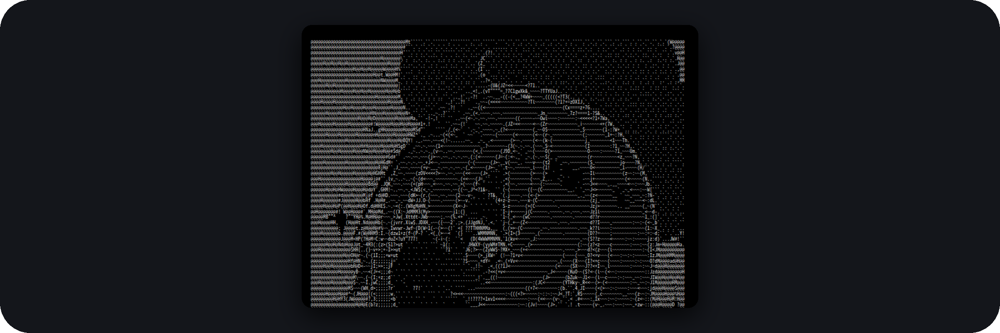

  

<a href="README.md">English</a> | <b>日本語</b>

<h1 align="center">Lapius7's GitHub Pages</h1>

<h3 align="center">Lapius7 の個人用ポートフォリオサイトのソース。</h3>

静的な <code>index.html</code> 1枚を GitHub Pages で配信しています。公開先は <a href="https://lapius7.github.io">lapius7.github.io</a> です。

  
  
  
  

  <a href="#概要">概要</a> ·
  <a href="#問い合わせ先">問い合わせ先</a> ·
  <a href="#ライセンス">ライセンス</a>

---

## 概要

このリポジトリには、[lapius7.github.io](https://lapius7.github.io) で公開しているポートフォリオ・ポータルサイトのコードがあります。ページには [GitHub](https://github.com/Lapius7) と [X](https://x.com/Lapius7) へのリンクがあります。

## 問い合わせ先

- **X (旧Twitter):** [@Lapius7](https://x.com/Lapius7)

## ライセンス

MIT License

Copyright (c) 2026 Lapius7
